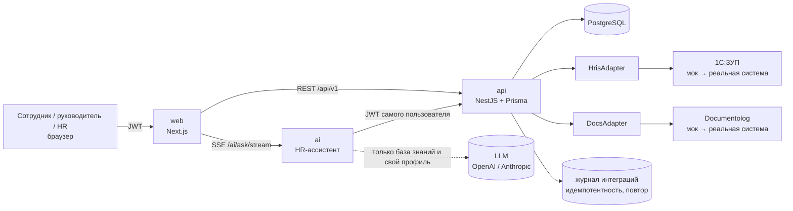

# JanaMen — единая цифровая HR-платформа

Кейс Jana Post × Terricon Valley Hackathon 2026, команда № 74. Сотрудник в одном окне видит профиль, заявки, обучение, уведомления и HR-ассистента; руководитель и HR согласуют заявки и следят за командой. Подробная спецификация — [`SPEC.md`](SPEC.md).

**Стек:** Next.js 16, React, TypeScript, Tailwind CSS, shadcn/ui · NestJS, Prisma, PostgreSQL · Hono, OpenAI API, Zod · Docker Compose.

## Запуск

```bash
docker compose up --build
```

Откройте http://localhost:3000 и войдите демо-аккаунтом — на странице входа есть кнопки быстрого входа. Необязательные настройки — ключ OpenAI для ассистента (`OPENAI_API_KEY`, модель по умолчанию `gpt-5.4-mini`; подходит и ключ Anthropic) и порты — задаются в корневом `.env`, см. [`.env.example`](.env.example). Без ключа или если модель недоступна, ассистент отвечает поиском по той же базе знаний.

### Без Docker

Нужны Node 22+ и PostgreSQL 16 с ролью и базой `janamen` (пароль `janamen`):

```bash
cd backend && cp .env.example .env && npm ci && npm run db:migrate && npm run db:seed && npm run build && npm start
cd ai && cp .env.example .env && npm ci && npm run dev
cd web && cp .env.example .env.local && npm ci && npm run dev
```

Вернуть свежие демо-данные: `cd backend && SEED_FORCE=1 npm run db:seed`.

| Сервис | Что это | Порт |
|---|---|---|
| `web` | интерфейс на Next.js ([web/](web/README.md)) | 3000 |
| `api` | бэкенд NestJS + Prisma ([backend/](backend/README.md)) | 8000 |
| `ai` | HR-ассистент ([ai/](ai/README.md)) | внутренний |
| `db` | PostgreSQL 16 | внутренний |

## Демо-аккаунты — пароль `demo1234`

| Email | Роль |
|---|---|
| `aigerim@jana.demo` | сотрудник |
| `daulet@jana.demo` | сотрудник (команда Ерлана) |
| `erlan@jana.demo` | руководитель |
| `asel@jana.demo` | сотрудник другого подразделения — Ерлану её профиль недоступен (403) |
| `dinara@jana.demo` | HR |

Данные тестовые, реальных персональных данных в репозитории нет.

## Демо-сценарий

1. **Айгерим** — главная: профиль, остаток отпуска, задачи, назначенный курс, уведомления.
2. Подаёт заявку на отпуск — через форму или фразой ассистенту «хочу в отпуск с 10 по 20 ноября»: даты, дни и остаток посчитаны, форма заполнена, остаётся проверить и отправить.
3. **Ерлан** видит заявку в «Согласованиях» и согласует. Профиль Асель из другого подразделения открывается как «Нет доступа» — API отвечает 403.
4. **Динара** проводит заявку → 1С:ЗУП и Documentolog (моки) → у Айгерим уведомление, обновлённый таймлайн и уменьшенный остаток.
5. Айгерим проходит назначенный курс и тест → прогресс и результат в профиле, уведомления ей и тому, кто назначил курс.
6. Ассистент: «Сколько дней отпуска положено?» → ответ с источником, печатается по словам; «Какая зарплата у Ерлана?» → отказ; вопрос вне базы знаний → честное «надёжного ответа нет» и кнопка «Передать в HR» (HR вместо этого видит подсказку дополнить базу знаний).
7. **Ерлан** — «Моя команда»: кто в отпуске, что ждёт его решения, просроченное обучение; согласует со страницы сотрудника, назначает курс, листает календарь отпусков по неделям, месяцам, кварталам и году.
8. **Динара** — HR-панель: заявки по статусам, неотвеченные вопросы ассистента, журнал интеграций; упавший вызов Documentolog повторяется с тем же ключом идемпотентности, без дублей.

## Архитектура



- **Роли и доступ.** Права проверяются на сервере для каждого запроса: своё / прямые подчинённые / всё для HR. Ассистент обращается к API с токеном текущего пользователя, поэтому видит только его данные.
- **Защита от выдумок.** Ответ ассистента показывается, только если каждая цитата дословно есть в статье базы знаний, а каждая цифра — в проверенной цитате. Иначе ассистент говорит, что надёжного ответа нет, и предлагает передать вопрос в HR. Кадровых решений AI не принимает: заявку он только готовит, отправляет и согласует человек.
- **Где подключаются 1С:ЗУП и Documentolog.** `backend/src/integrations`: бизнес-логика работает только с интерфейсами `HrisAdapter` и `DocsAdapter`, сейчас за ними мок-адаптеры. Реальная система — это новый класс и одна привязка в `IntegrationsModule`. Каждый вызов пишется в журнал с ключом идемпотентности (номер заявки) и таймаутом; сбой 1С не откатывает одобрение — HR видит ошибку в журнале и повторяет вызов. Подробнее — [backend/README.md](backend/README.md#integration-architecture).

## Реализовано / смоделировано / дальше

| | |
|---|---|
| **Реализовано** | вход и роли с проверкой прав на сервере; заявки на отпуск и аванс с двухэтапным согласованием и историей; уведомления; Jana Academy — курсы, уроки, тест, прогресс, назначение курсов; кабинет руководителя — команда, согласования, обучение команды; интерактивный календарь отпусков; HR-панель; ассистент с источниками, отказами, эскалацией в HR, автозаполнением заявок и потоковым ответом; база знаний с редактированием для HR через API; журнал интеграций с повтором; интерфейс на русском и казахском, адаптивная вёрстка |
| **Смоделировано** | 1С:ЗУП (синхронизация сотрудников, проведение отпусков и авансов) и Documentolog (заявления на подпись) — мок-адаптеры за `HrisAdapter` / `DocsAdapter`; тестовые сотрудники и демо-регламенты базы знаний |
| **Дальше** | реальные адаптеры 1С и Documentolog, очередь фоновых повторов, статус подписи из Documentolog, корпоративный вход (SSO), ЭЦП, новые типы заявок и HR-модули |

## Проверки

- `cd backend && npm test` — 61 e2e-тест API против PostgreSQL (тестовая база задаётся в `TEST_DATABASE_URL`).
- `cd ai && npm test` — 122 теста ассистента; `npm run eval` — 30 эталонных вопросов: ответ по базе, нет ответа, отказ, автозаполнение заявки.

## Команда

- **Дулатулы Нурасыл** — frontend, UX, AI-ассистент
- **Владимир Дон** — backend, интеграции
