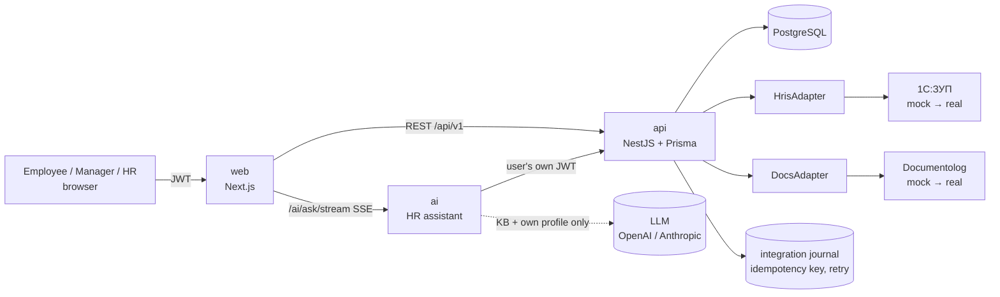

# JanaMen — Digital HR Platform

Jana Post × Terricon Valley Hackathon 2026. One web platform where an employee sees their profile, requests, training, notifications and an HR assistant; managers and HR approve and track. Spec: [`SPEC.md`](SPEC.md).

## Run

```bash
docker compose up --build
```

Open http://localhost:3000 and use a demo account (one-click buttons on the login page). Optional settings — an OpenAI key for the assistant (`OPENAI_API_KEY`, default model `gpt-5.4-mini`; an Anthropic key works too), ports — go in a root `.env`, see [`.env.example`](.env.example). Without a key, or if the model is unavailable, the assistant answers in keyword-search fallback mode over the same knowledge base.

### Without Docker

Node 22+ and PostgreSQL 16 with a `janamen` role and database (password `janamen`):

```bash
cd backend && cp .env.example .env && npm ci && npm run db:migrate && npm run db:seed && npm run build && npm start
cd ai && cp .env.example .env && npm ci && npm run dev
cd web && cp .env.example .env.local && npm ci && npm run dev
```

Fresh demo data at any time: `cd backend && SEED_FORCE=1 npm run db:seed`.

| Service | | Port |
|---|---|---|
| `web` | Next.js UI ([web/](web/README.md)) | 3000 |
| `api` | NestJS + Prisma backend ([backend/](backend/README.md)) | 8000 |
| `ai` | HR assistant service ([ai/](ai/README.md)) | internal |
| `db` | PostgreSQL 16 | internal |

## Demo accounts — password `demo1234`

| Email | Role |
|---|---|
| `aigerim@jana.demo` | employee |
| `daulet@jana.demo` | employee (Erlan's team) |
| `erlan@jana.demo` | manager |
| `asel@jana.demo` | employee (other department — Erlan gets 403) |
| `dinara@jana.demo` | HR |

## Demo scenario

1. **Айгерим** — home: profile, vacation balance, tasks, course, notifications.
2. Files a vacation request — via the form, or by telling the assistant «хочу в отпуск с 10 по 20 ноября», which pre-fills the form.
3. **Ерлан** sees it in Approvals and approves. Opening Асель's profile shows «Нет доступа» — the API returns 403.
4. **Динара** posts it → 1С:ЗУП and Documentolog (mocked) → Айгерим gets a notification, the timeline updates, the balance drops.
5. Айгерим completes the assigned course and quiz → progress in her profile, notification.
6. Assistant: «Сколько дней отпуска положено?» → answer with source, typed out word by word; «Какая зарплата у Ерлана?» → refusal; unknown question → «Передать в HR» (HR users get a hint to add a KB article instead).
7. **Ерлан** — «Моя команда»: who is on vacation, what waits for his decision, overdue training; approves from a member's page, assigns a course, scrolls the vacation calendar by week / month / quarter / year.
8. **Динара** — HR panel: request pipeline, unanswered assistant questions, integration journal; a failed Documentolog call is retried with the same idempotency key, without duplicates.

## Architecture

```
Browser ──JWT──▶ web (Next.js) ──/ai/*──▶ ai ──JWT of the user──▶ api ──▶ PostgreSQL
   └────────────────JWT─────────────────────────────────────────▶ api ──▶ HrisAdapter ─▶ 1С:ЗУП (mock)
                                                                      └─▶ DocsAdapter ─▶ Documentolog (mock)
```



The assistant calls the API with the current user's token, so it can only ever see that user's data. Every answer is checked on the server before it is shown: each cited quote must exist verbatim in the knowledge base and every number must come from a verified quote, otherwise the assistant says it has no reliable answer. Integration details: [backend/README.md](backend/README.md#integration-architecture).

## Implemented / mocked / next

| | |
|---|---|
| **Implemented** | auth & roles with server-side data scopes, requests with two-stage approval and timeline, notifications, academy with quizzes and course assignment, manager workspace (team overview, inline approvals, team training), interactive vacation calendar (week / month / quarter / year), HR dashboard, assistant with sources / refusals / escalation / pre-filled requests and streamed answers, knowledge base editing, integration journal with idempotent retry, RU / KZ interface |
| **Mocked** | 1С:ЗУП (employee sync, posting vacations/advances) and Documentolog (applications for signature) — behind `HrisAdapter` / `DocsAdapter`; replacing a mock is one class |
| **Next** | real 1С and Documentolog adapters, e-signature, embeddings once the knowledge base grows, native mobile app |
